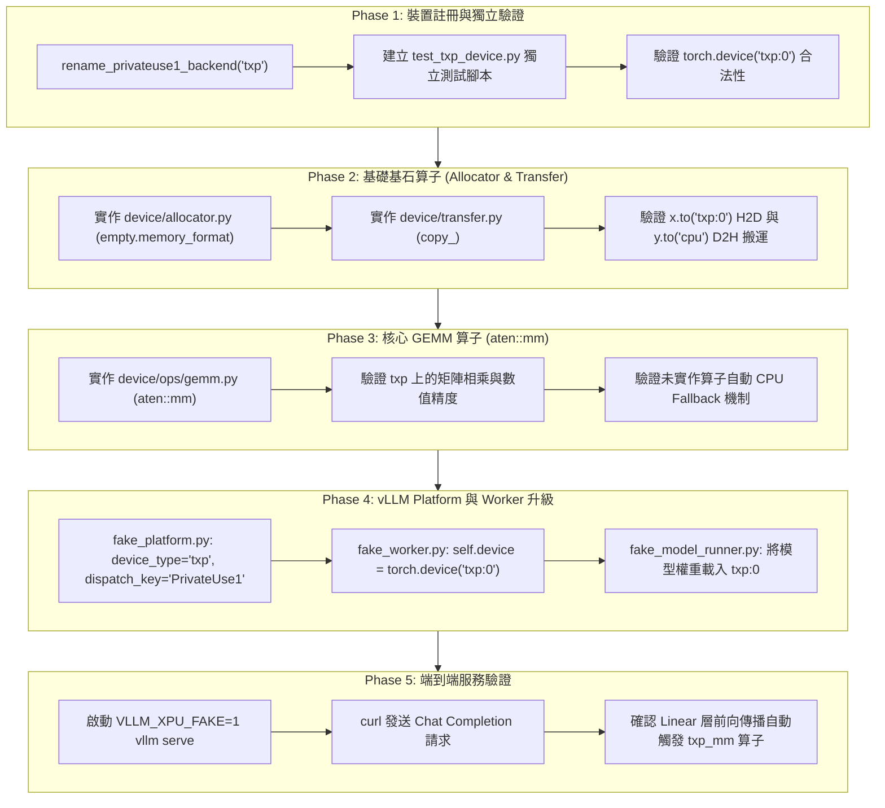

# TODO：XPU PrivateUse1 自訂硬體驅動實作計畫

> **專案目標**：  
> 將目前的 `vllm-xpu-minimal` 插件從「純 CPU 軟體模擬（Fake XPU）」升級為**「標準 PrivateUse1 獨立硬體裝置架構」**。  
> 透過 PyTorch 官方 `torch.utils.rename_privateuse1_backend("txp")` 與 `torch.library` 派發機制，打造專屬的非 CPU 獨立裝置上下文（`torch.device("txp:0")`）、顯存配置器、H2D/D2H 跨裝置資料搬運，以及以「1 個 GEMM 算子」起步的 LLM 漸進式推論硬體閉環。

---

## 📌 分支資訊
* **主專案分支**：`feat/igpu-directml` (`/mnt/d/work/xpu`)
* **插件子模組分支**：`feat/igpu-directml` (`/mnt/d/work/xpu/vllm-xpu-minimal`)
* **技術路線**：路線 B（PyTorch 官方標準 `PrivateUse1` 派發架構，守住 PyTorch 2.13 環境）

---

## 🏗️ 架構設計全景：從 Fake CPU 到 PrivateUse1 獨立硬體

---

## 📋 逐步實作任務清單（Milestones & Tasks）

### 階段一：裝置註冊與獨立驗證
- [x] **Task 1.1**：驗證當前 PyTorch 2.13 環境下 `torch.utils.rename_privateuse1_backend('txp')` 可行性（已驗證通過）。
- [ ] **Task 1.2**：建立獨立驗證腳本 `tests/test_txp_device.py`：
  - 測試 `torch.device("txp:0")` 建立。
  - 測試 `torch.txp` 模組動態綁定與能力探測。

---

### 階段二：基礎基石算子實作（顯存配置與跨裝置搬運）
- [ ] **Task 2.1**：建立 `vllm_xpu_minimal/device/` 模組結構：
  - `device/__init__.py`：暴露裝置初始化與註冊進入點。
  - `device/txp_backend.py`：封裝後端重命名與裝置上下文管理。
- [ ] **Task 2.2**：實作 `device/allocator.py`：
  - 註冊 `aten::empty.memory_format` 派發實作，建立 `device='txp:0'` 的專屬 Storage。
- [ ] **Task 2.3**：實作 `device/transfer.py`：
  - 註冊 `aten::copy_` 派發實作，處理 `cpu -> txp`（H2D）與 `txp -> cpu`（D2H）的真實張量拷貝。

---

### 階段三：核心 GEMM 算子實作與 CPU Fallback 驗證
- [ ] **Task 3.1**：實作 `device/ops/gemm.py`：
  - 註冊 `aten::mm` 派發實作，處理 `txp` 裝置上的二維矩陣乘法。
- [ ] **Task 3.2**：驗證 CPU Fallback 機制：
  - 測試在 `txp:0` 上執行未註冊的算子（如 `aten::add` 或 `aten::sin`），確認 PyTorch 能優雅自動 fallback 至 CPU 完成計算。

---

### 階段四：vLLM 插件架構全面升級為 PrivateUse1
- [ ] **Task 4.1**：修改 [`platforms/fake_platform.py`](file:///mnt/d/work/xpu/vllm-xpu-minimal/vllm_xpu_minimal/platforms/fake_platform.py)：
  - `device_type = "txp"`（正式告別 `"cpu"` 標籤！）。
  - `dispatch_key = "PrivateUse1"`。
  - `current_device()` 回傳 `torch.device("txp:0")`。
- [ ] **Task 4.2**：修改 [`v1/worker/fake_worker.py`](file:///mnt/d/work/xpu/vllm-xpu-minimal/vllm_xpu_minimal/v1/worker/fake_worker.py)：
  - `init_device()` 正式將 `self.device = torch.device("txp:0")`。
  - 日誌輸出：「[XPUFakeWorker] Device initialized: txp:0 (PrivateUse1 Device attached)」。
- [ ] **Task 4.3**：修改 [`v1/worker/fake_model_runner.py`](file:///mnt/d/work/xpu/vllm-xpu-minimal/vllm_xpu_minimal/v1/worker/fake_model_runner.py)：
  - 在 `load_model()` 中將權重放置到 `self.device`（即 `txp:0`）。

---

### 階段五：端到端服務推論測試與成果提交
- [ ] **Task 5.1**：啟動 `VLLM_XPU_FAKE=1 vllm serve Qwen/Qwen2.5-0.5B-Instruct`。
- [ ] **Task 5.2**：執行 `curl` 發送端到端 Chat Completion 請求，確認文字流暢生成。
- [ ] **Task 5.3**：觀測日誌，確認 Qwen 模型的全部 Linear 層皆成功派發給 `txp_mm` 算子執行。
- [ ] **Task 5.4**：Git Commit 並 Push 到遠端分支 `feat/igpu-directml`。
