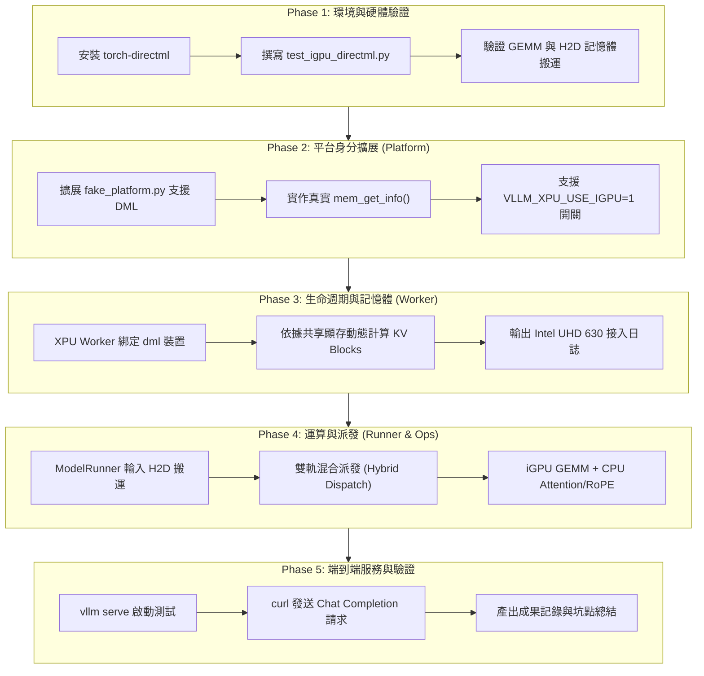

# TODO：iGPU (Intel UHD 630) DirectML 整合實作計畫

> **專案目標**：  
> 將目前的 `vllm-xpu-minimal` 插件從「純 CPU 軟體模擬（Fake XPU）」升級為**「支援 WSL2 本機 Intel iGPU 實體加速晶片的真實異質插件」**。  
> 透過微軟 DirectML 橋接 `/dev/dxg`，實踐真實的非 CPU 獨立裝置上下文（Device Context）、真實的 Host-to-Device (H2D) 與 Device-to-Host (D2H) 記憶體搬運、動態顯存探測，以及異質計算派發架構。

---

## 📌 分支資訊
* **主專案分支**：`feat/igpu-directml` (`/mnt/d/work/xpu`)
* **插件子模組分支**：`feat/igpu-directml` (`/mnt/d/work/xpu/vllm-xpu-minimal`)
* **硬體目標**：`Intel(R) UHD Graphics 630`（Coffee Lake Gen9，WSL2 `/dev/dxg` 介面）

---

## 🏗️ 架構設計全景：從 Fake CPU 到真實異質 XPU

---

## 📋 逐步實作任務清單（Milestones & Tasks）

### 階段一：環境整備與 DirectML 獨立硬體驗證
- [ ] **Task 1.1**：在虛擬環境 (`/mnt/d/work/xpu/vllm-xpu-minimal/path/to/venv.`) 中安裝 `torch-directml` 套件。
- [ ] **Task 1.2**：撰寫獨立驗證腳本 `tests/test_igpu_directml.py`：
  - 測試 DirectML 裝置探測（`torch_directml.device()`）。
  - 測試 Host CPU 張量透過 `.to(dml)` 搬入 iGPU（H2D 搬移驗證）。
  - 測試在 Intel UHD 630 上執行矩陣乘法（GEMM）計算。
  - 測試計算結果透過 `.to('cpu')` 搬回 Host（D2H 搬移驗證）。
- [ ] **Task 1.3**：探測 DirectML 記憶體讀取介面（或 DXGI 介面），評估可用顯存大小。

---

### 階段二：平台層升級（XPU Platform 身分與能力擴展）
- [ ] **Task 2.1**：在 `envs.py` 中新增 `VLLM_XPU_USE_IGPU`（預設為 0，設定為 1 時啟用 DirectML iGPU 後端）。
- [ ] **Task 2.2**：修改 [`platforms/fake_platform.py`](file:///mnt/d/work/xpu/vllm-xpu-minimal/vllm_xpu_minimal/platforms/fake_platform.py)：
  - 實作動態裝置判斷：若啟用 iGPU，`device_type = "dml"` 或相容的裝置字串。
  - 實作 `get_device_name()`：動態回傳 `"Intel(R) UHD Graphics 630 (DirectML)"`。
  - 實作 `set_device()` 與 `current_device()`：不再只是 dummy no-op，而是真正管理 DirectML 裝置上下文。
  - 實作 `mem_get_info()`：動態回傳真實的可用顯存與總顯存位元組。

---

### 階段三：管家層改造（Worker 生命週期與顯存探測）
- [ ] **Task 3.1**：更新 [`v1/worker/fake_worker.py`](file:///mnt/d/work/xpu/vllm-xpu-minimal/vllm_xpu_minimal/v1/worker/fake_worker.py)：
  - 在 `init_device()` 中偵測到 iGPU 時，印出真實的硬體連線橫幅：
    * `Device: Intel(R) UHD Graphics 630 (DirectML)`
    * `Interface: Microsoft Dxgkrnl via /dev/dxg`
  - 將 `self.device` 綁定為 `torch_directml.device()`。
- [ ] **Task 3.2**：改進 `determine_available_memory()`：
  - 依據 iGPU 的可用顯存（或安全配額，例如 1.5 GiB），動態計算可分配的 KV Cache Blocks，避免 OOM。

---

### 階段四：運算與派發層設計（ModelRunner H2D 搬運與異質執行）
- [ ] **Task 4.1**：評估與確認算子派發策略：
  - **策略評估**：由於 DirectML 缺乏針對 vLLM PagedAttention / RoPE 的特化 C++ Kernel，評估以下兩條路線：
    - **路線 A（全模型放 iGPU）**：若 PyTorch 原生算子全覆蓋，嘗試將整個模型權重放入 DirectML。
    - **路線 B（推薦：異質雙軌派發 Hybrid Execution）**：
      - 模型權重與 GEMM 運算置於 iGPU 執行。
      - 複雜的 PagedAttention 與 RoPE 算子動態切換/留在 CPU 上完成，展示標準 Level 2 跨裝置調度能力。
- [ ] **Task 4.2**：在 [`v1/worker/fake_model_runner.py`](file:///mnt/d/work/xpu/vllm-xpu-minimal/vllm_xpu_minimal/v1/worker/fake_model_runner.py) 實作輸入張量的顯式 H2D 搬移與輸出 D2H 搬回。

---

### 階段五：端到端服務驗證與成果歸檔
- [ ] **Task 5.1**：啟動 `VLLM_XPU_USE_IGPU=1 vllm serve Qwen/Qwen2.5-0.5B-Instruct`。
- [ ] **Task 5.2**：執行 `curl` 發送端到端 Chat Completion 請求，確認生成文字流暢無誤。
- [ ] **Task 5.3**：在推論過程中觀察 Windows 工作管理員 / GPU 使用率，確認 Intel UHD 630 確實有運算負載。
- [ ] **Task 5.4**：更新專案 README 與架構手冊，將本次實踐經驗收錄為「從 Fake XPU 邁向真實異質裝置（iGPU）的演進之路」。
- [ ] **Task 5.5**：Git Commit 並 Push 到遠端分支 `feat/igpu-directml`。

---

## 🎯 驗收標準（Definition of Done）
1. `test_igpu_directml.py` 成功在 Intel UHD 630 上執行張量運算並通過測試。
2. vLLM Server 啟動日誌明確印出 `[XPUWorker] Connected to Intel(R) UHD Graphics 630`。
3. 執行推論時有真實的 H2D / D2H 資料傳輸，且 `/v1/chat/completions` 能正確生成回答。
4. 所有程式碼整潔提交，文檔齊全。
